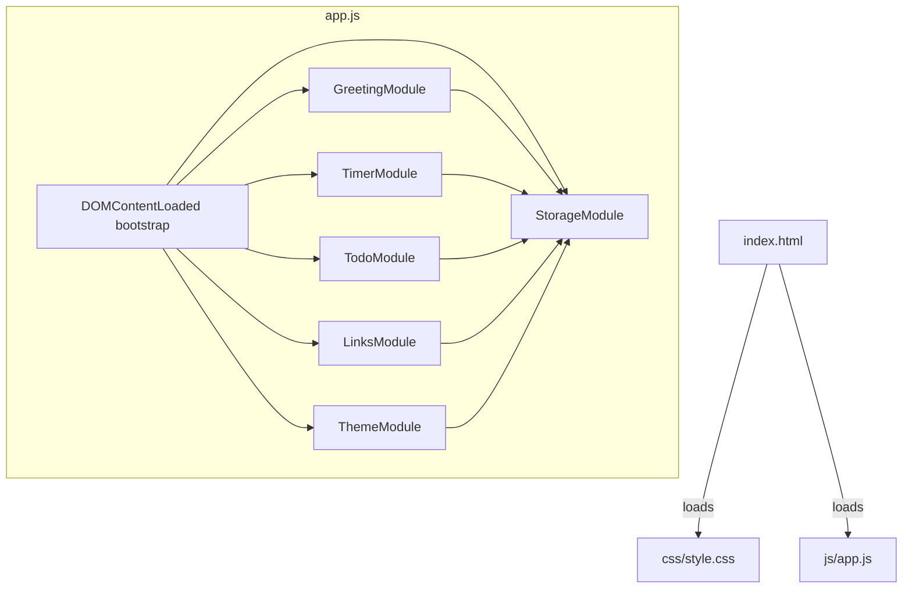
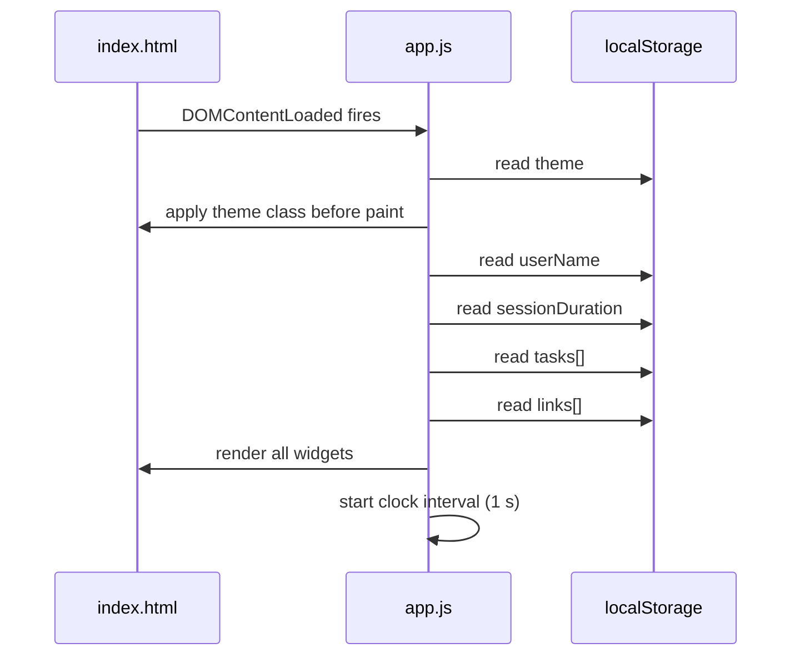

# Design Document

## Overview

The To-Do Life Dashboard is a zero-dependency, single-page web application implemented in plain HTML, CSS, and Vanilla JavaScript. It provides four interactive widgets — a live greeting/clock, a configurable Pomodoro timer, a persistent to-do list, and a quick-links panel — all wired together on one page with no build step, no framework, and no server.

All persistent state is stored in the browser's `localStorage` API. Because the entire application runs client-side, there is no backend, no network request for data, and no authentication layer. The design goal is maximum simplicity: one HTML file, one CSS file, one JavaScript file.

**Key design constraints (from Requirement 8):**
- `index.html` — entry point, no inline `<script>` or `<style>` blocks
- `css/style.css` — all styles, color values via CSS custom properties
- `js/app.js` — all JavaScript logic

---

## Architecture

The application follows a **Module Pattern** inside a single `app.js` file. Each widget is an isolated module with its own init, render, and event-handler functions. A thin shared layer handles localStorage access and theme management.



### Module Responsibilities

| Module | Responsibility |
|---|---|
| `GreetingModule` | Clock interval, date formatting, greeting phrase selection, user-name display |
| `TimerModule` | Countdown interval, start/stop/reset logic, session-duration validation, audible alert, browser notification |
| `TodoModule` | Task CRUD, inline edit, validation, strikethrough toggle |
| `LinksModule` | Link CRUD, URL/label validation, duplicate detection, new-tab open |
| `ThemeModule` | Toggle, CSS class application, `prefers-color-scheme` fallback |
| `StorageModule` | Thin wrapper around `localStorage` with try/catch error handling |

### Initialization Sequence



---

## Components and Interfaces

### GreetingModule

```
GreetingModule.init()
  - Reads userName from StorageModule
  - Starts setInterval (1000 ms) → tick()

tick()
  - Gets current Date
  - Formats time → HH:MM:SS
  - Formats date → "Weekday, DD Month YYYY"
  - Calls getGreetingPhrase(hour) → string
  - Renders greeting + optional userName into DOM

getGreetingPhrase(hour: number): string
  - 05–11  → "Good Morning"
  - 12–17  → "Good Afternoon"
  - 18–20  → "Good Evening"
  - 21–23 | 00–04 → "Good Night"
```

**DOM targets:**
- `#clock` — HH:MM:SS time display
- `#date-display` — formatted date
- `#greeting` — full greeting string
- `#name-input` — text input for user name
- `#name-save-btn` — save button
- `#name-validation-msg` — inline validation message

---

### TimerModule

```
TimerModule.init()
  - Reads sessionDuration from StorageModule (default 25)
  - Renders MM:SS display
  - Attaches event listeners: Start, Stop, Reset, duration input

start()   — launches setInterval (1000 ms), updates button states
stop()    — clears interval, updates button states
reset()   — clears interval, restores display to sessionDuration
tick()    — decrements remaining seconds; if 0 → onComplete()
onComplete()
  - Clears interval
  - Plays AudioContext beep (Web Audio API)
  - If Notification.permission === "granted" → shows browser notification
  - Updates button states

formatCountdown(totalSeconds: number): string
  - Returns "MM:SS" zero-padded string

validateDuration(value: string): { valid: boolean, value: number, message: string }
  - Parses integer; rejects non-integers and values outside [1, 90]
```

**DOM targets:**
- `#timer-display` — MM:SS countdown
- `#start-btn`, `#stop-btn`, `#reset-btn`
- `#duration-input` — numeric input
- `#duration-validation-msg` — inline validation message

---

### TodoModule

```
TodoModule.init()
  - Loads tasks[] from StorageModule
  - Renders all tasks
  - Attaches event listener on add-form submit

addTask(description: string): void
  - Validates: trimmed length 1–250
  - Creates Task object → appends to tasks[]
  - Persists → re-renders

toggleComplete(id: string): void
  - Flips task.completed boolean → persists → re-renders

beginEdit(id: string): void
  - Replaces task row with inline edit field

saveEdit(id: string, newText: string): void
  - Validates: trimmed length 1–250
  - Updates task.text → persists → re-renders

deleteTask(id: string): void
  - Removes task from tasks[] → persists → re-renders

renderTasks(): void
  - Builds task list DOM from tasks[]
  - Applies strikethrough class to completed tasks
```

**DOM targets:**
- `#task-input` — new task text input
- `#add-task-btn`
- `#task-list` — `<ul>` container
- `#task-validation-msg` — inline validation

---

### LinksModule

```
LinksModule.init()
  - Loads links[] from StorageModule
  - Renders all links
  - Attaches event listener on add-form submit

addLink(label: string, url: string): void
  - Validates label: non-empty
  - Validates url: starts with "http://" or "https://"
  - Checks for exact duplicate (label + url)
  - Appends Link → persists → re-renders

deleteLink(id: string): void
  - Removes from links[] → persists → re-renders

renderLinks(): void
  - Builds link button list; each opens URL in new tab (_blank + rel="noopener")
```

**DOM targets:**
- `#link-label-input`, `#link-url-input`
- `#add-link-btn`
- `#links-panel` — container for link buttons
- `#link-validation-msg` — inline validation

---

### ThemeModule

```
ThemeModule.init()
  - Reads theme from StorageModule
  - If none: reads prefers-color-scheme
  - Applies "dark" or "light" class to <html> element immediately

toggle(): void
  - Flips current theme → applies class → persists
```

**DOM targets:**
- `<html>` element — receives `class="dark"` or `class="light"`
- `#theme-toggle-btn`

---

### StorageModule

```
StorageModule.get(key: string): any | null
  - try { return JSON.parse(localStorage.getItem(key)) }
  - catch { return null }

StorageModule.set(key: string, value: any): boolean
  - try { localStorage.setItem(key, JSON.stringify(value)); return true }
  - catch { return false }

StorageModule.remove(key: string): void
  - localStorage.removeItem(key)
```

**Storage keys:**

| Key | Type | Description |
|---|---|---|
| `tld_theme` | `"light" \| "dark"` | Active color theme |
| `tld_userName` | `string` | User's display name |
| `tld_sessionDuration` | `number` | Pomodoro session minutes |
| `tld_tasks` | `Task[]` | Ordered array of task objects |
| `tld_links` | `Link[]` | Array of quick-link objects |

---

## Data Models

### Task

```javascript
{
  id: string,          // crypto.randomUUID() or Date.now().toString()
  text: string,        // 1–250 characters, trimmed
  completed: boolean,  // false on creation
  createdAt: number    // Date.now() timestamp
}
```

### Link

```javascript
{
  id: string,    // crypto.randomUUID()
  label: string, // non-empty display label
  url: string    // must start with "http://" or "https://"
}
```

### AppState (in-memory only, not persisted as a single object)

```javascript
{
  userName: string | null,
  theme: "light" | "dark",
  sessionDuration: number,        // minutes, 1–90
  timerRemaining: number,         // seconds, runtime only
  timerRunning: boolean,          // runtime only
  tasks: Task[],
  links: Link[]
}
```

---

## Correctness Properties

*A property is a characteristic or behavior that should hold true across all valid executions of a system — essentially, a formal statement about what the system should do. Properties serve as the bridge between human-readable specifications and machine-verifiable correctness guarantees.*

### Property 1: Greeting phrase covers all 24 hours

*For any* integer hour in [0, 23], `getGreetingPhrase(hour)` SHALL return exactly one of "Good Morning", "Good Afternoon", "Good Evening", or "Good Night", with no hour left unmapped and no hour mapped to two phrases.

**Validates: Requirements 1.3, 1.4, 1.5, 1.6**

---

### Property 2: User name trimming and storage round-trip

*For any* string composed of at least one non-whitespace character, trimming it and saving it to storage, then reading it back, SHALL produce a string equal to the trimmed original.

**Validates: Requirements 2.2, 2.3**

---

### Property 3: Whitespace-only name treated as empty

*For any* string composed entirely of whitespace characters (spaces, tabs, newlines), submitting it as a User_Name SHALL result in the storage containing no User_Name entry, identical to the case where no name was ever saved.

**Validates: Requirements 2.7**

---

### Property 4: Timer countdown format is always valid MM:SS

*For any* integer total-seconds value in [0, 5400] (0 to 90 minutes), `formatCountdown(seconds)` SHALL return a string of exactly five characters matching the pattern `[0-9]{2}:[0-9]{2}`, where the minutes part equals `Math.floor(seconds / 60)` zero-padded and the seconds part equals `seconds % 60` zero-padded.

**Validates: Requirements 3.1, 3.2**

---

### Property 5: Session-duration validation rejects out-of-range values

*For any* integer outside [1, 90] (including 0, negatives, and values above 90), `validateDuration` SHALL return `{ valid: false }`, and *for any* integer strictly within [1, 90], it SHALL return `{ valid: true, value: n }`.

**Validates: Requirements 4.1, 4.6**

---

### Property 6: Task addition round-trip preserves data

*For any* valid task description (trimmed, 1–250 characters), adding it to the task list and then reading the task list from storage SHALL produce a list whose last element has a `text` field equal to the trimmed description and a `completed` field equal to `false`.

**Validates: Requirements 5.2, 5.10**

---

### Property 7: Whitespace-only task descriptions are rejected

*For any* string composed entirely of whitespace characters, attempting to add it as a task description SHALL leave the task list unchanged (same length and same contents as before the attempt).

**Validates: Requirements 5.3**

---

### Property 8: Toggle-complete is an involution

*For any* task in any completion state, toggling it twice SHALL return it to its original completion state, and the task list length SHALL remain unchanged throughout.

**Validates: Requirements 5.4, 5.5**

---

### Property 9: URL validation accepts only http/https schemes

*For any* string that does NOT begin with exactly "http://" or "https://", the URL validator SHALL return invalid. *For any* string that begins with "http://" or "https://", the URL validator SHALL return valid.

**Validates: Requirements 6.2, 6.4**

---

### Property 10: Duplicate link detection

*For any* links list and any link whose label and URL both exactly match an existing entry, attempting to add it SHALL leave the links list unchanged.

**Validates: Requirements 6.10**

---

### Property 11: Storage serialization round-trip for tasks and links

*For any* array of Task objects and any array of Link objects, serializing each to storage via `StorageModule.set` and immediately deserializing via `StorageModule.get` SHALL produce arrays structurally equal to the originals (same length, same field values in same order).

**Validates: Requirements 5.10, 5.12, 6.7, 6.8**

---

### Property 12: Theme toggle is an involution

*For any* starting theme ("light" or "dark"), calling `ThemeModule.toggle()` twice SHALL result in the same theme as the starting state, and the `<html>` element's class SHALL reflect the theme after each toggle.

**Validates: Requirements 7.2, 7.3**

---

## Error Handling

### localStorage Unavailability

`StorageModule.set` / `StorageModule.get` wrap every `localStorage` call in a `try/catch`. If `localStorage` throws (private browsing, storage quota exceeded, Safari ITP), the module returns `null` / `false` without rethrowing. Callers check the return value:

- `TodoModule` / `LinksModule`: if `set` returns `false`, display `#task-validation-msg` / `#link-validation-msg` with "Change could not be saved."
- `ThemeModule` on load: if `get` returns `null`, fall back to `prefers-color-scheme`.
- `TodoModule` on load: if `get` returns `null` or non-array, render empty list + display "Saved tasks could not be loaded."

### Input Validation Errors

All validation errors are surfaced as inline messages next to the relevant input field. No modal dialogs or page-level alerts are used. Validation messages are cleared when the user next modifies the input.

### Browser Notification Permission

The app calls `Notification.requestPermission()` only once, triggered by the user pressing Start for the first time. If permission is denied or the API is unavailable, `TimerModule.onComplete` skips the notification and relies solely on the Web Audio API beep. No error is shown to the user in this case.

### Timer Edge Cases

- If the page is hidden (tab backgrounded) while the timer runs, `setInterval` may drift. The timer uses a start-timestamp approach: on each tick it computes `remaining = targetEndTime - Date.now()` rather than decrementing a counter, preventing visible drift.
- The Reset action clears any active interval before restoring state, preventing double-interval bugs.

---

## Testing Strategy

### Approach

This project uses a **dual testing approach**:

1. **Unit / example-based tests** — verify specific behaviors, edge cases, and error conditions using concrete inputs.
2. **Property-based tests** — verify universal correctness properties across many generated inputs.

Because the bulk of the application's logic consists of pure or near-pure functions (greeting phrase selection, timer formatting, input validation, storage serialization), property-based testing is well-suited and cost-effective.

**Property-based testing library:** [fast-check](https://github.com/dubzzz/fast-check) (JavaScript, runs in Node via a test runner such as Vitest or Jest, no build step required for logic-layer tests).

### Unit Tests (Example-Based)

Focus areas:
- **GreetingModule**: Specific hour boundaries (04→05, 11→12, 17→18, 20→21, 23→00) produce the correct phrase transition.
- **TimerModule**: Start → Stop leaves remaining seconds unchanged; Reset restores to session duration; `onComplete` fires audible alert.
- **TodoModule**: Add task renders in DOM; edit updates text; delete removes from list; storage-failure path shows error message.
- **LinksModule**: Valid link adds successfully; empty label rejected; empty URL rejected; non-http/https URL rejected; duplicate rejected.
- **ThemeModule**: Reads `prefers-color-scheme` when no saved theme exists; applies class to `<html>` before first paint.
- **StorageModule**: Returns `null` on parse error; returns `false` on `localStorage.setItem` throw; `remove` clears the key.

### Property-Based Tests

Each property below maps to a Correctness Property in the design. Tests run a minimum of **100 iterations** each.

Tag format used in test files: `// Feature: todo-life-dashboard, Property N: <property_text>`

| Property | Test Description | fast-check Arbitraries |
|---|---|---|
| 1 | Greeting phrase covers all 24 hours | `fc.integer({ min: 0, max: 23 })` |
| 2 | User name trim + storage round-trip | `fc.string().filter(s => s.trim().length > 0)` |
| 3 | Whitespace-only name treated as empty | `fc.stringOf(fc.constantFrom(' ', '\t', '\n'))` |
| 4 | Timer countdown format always valid | `fc.integer({ min: 0, max: 5400 })` |
| 5 | Duration validation rejects out-of-range | `fc.integer()` partitioned into valid/invalid ranges |
| 6 | Task addition round-trip | `fc.string({ minLength: 1, maxLength: 250 }).filter(s => s.trim().length > 0)` |
| 7 | Whitespace-only task rejected | `fc.stringOf(fc.constantFrom(' ', '\t', '\n'), { minLength: 1 })` |
| 8 | Toggle-complete is an involution | `fc.boolean()` (initial completed state) + `fc.array(fc.record(...))` |
| 9 | URL validation accepts only http/https | `fc.webUrl()` (valid) + `fc.string()` filtered to exclude http/https prefix (invalid) |
| 10 | Duplicate link detection | `fc.array(fc.record({ label: fc.string(), url: fc.webUrl() }))` |
| 11 | Storage serialization round-trip | `fc.array(fc.record({ id: fc.uuidV(4), text: fc.string({ minLength: 1, maxLength: 250 }), completed: fc.boolean(), createdAt: fc.integer() }))` |
| 12 | Theme toggle involution | `fc.constantFrom("light", "dark")` |

### Integration Tests

- Load `index.html` in a headless browser (Playwright or jsdom) and verify:
  - Theme class is applied before first visible paint (no FOUC).
  - Tasks saved in one "session" (localStorage seeded) are rendered on next load.
  - Links panel scrolls when more than 20 links are present.
  - Timer notification path (mock `Notification` API).

### Browser Compatibility

Manual verification in Chrome, Firefox, Edge, and Safari stable releases (Requirement 9). Automated cross-browser runs via Playwright if CI is configured.
